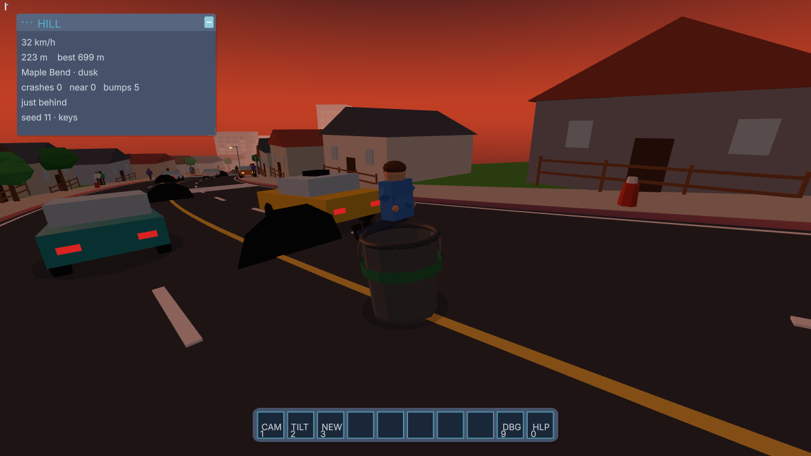
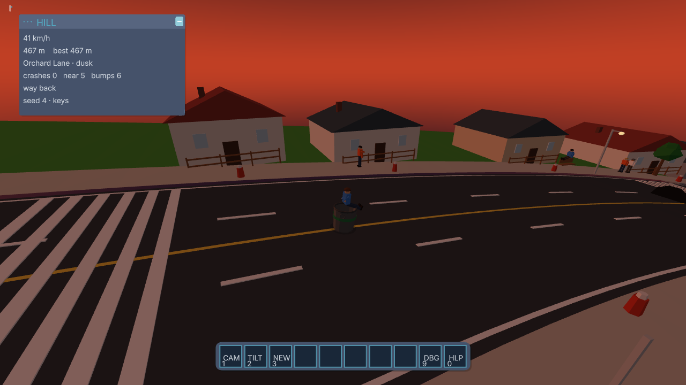

# Garbage Can Race

A person sits in a garbage can and rolls an endless hill through a low-poly town. Parked cars, moving cars, people, and potholes get in the way. The road runs through downtown blocks, house rows, and a market street, at dawn, day, dusk, or night.

This repo is a capability demo of two pieces that stay in their own lanes:

- **Grok 4.7** took one prompt and built the game on a library it had to read first.
- **[vr-halo](https://github.com/Rick-Boardman/vr-halo)** (`@rb/halo` 0.2.0) already owned the scene rig, desktop navigation, WebXR session, controllers, and the in-canvas HUD.





## What Grok 4.7 did

The prompt arrived on 2026-11-05 at 07:14 EST. The playable game was reported at 08:10 EST, in the same session.

The prompt asked for a person in a garbage can, rolling downhill through a town like the attached low-poly street references, avoiding obstacles. Desktop play had to use the navigation Halo already ships. VR steering had to come from controller height: the lower hand turns that way, both hands down go faster, both hands up lean back and slow down. Phone tilt had to steer and throttle when the browser exposes it. The hill needed random scenes and slopes, three cameras, parked cars, moving cars, people doing ordinary things, potholes, and different times of day.

Grok 4.7 then:

- Read the installed Halo 0.2.0 sources before writing the race: scene bootstrap, the rig, desktop navigation, controller parenting, and the HUD. Desktop look is Halo's scheme: mouse drag, Q/E yaw, R/F pitch, plus the WASD, Shift, and X keys Halo already records.
- Set Halo locomotion speed to zero. Those keys and the VR sticks still update Halo's input state, and the ride reads that state. The rig stays on the hill because the game writes its position every frame.
- Mapped the ride onto that input. A and D steer. W, Shift, and X tuck to go faster. S brakes. V or 1, 2, and 3 switch the camera. N starts a new hill.
- Built the endless course, three district types, traffic, pedestrians, potholes, the rider, and dawn-to-night lighting. The opening district stays day or dawn so the first stretch is readable. Later districts include dusk and night. Night stays lit enough to play. Buildings, cars, people, and the can are procedural meshes and canvas textures.
- Fed VR from Halo's controller poses. The lower hand steers to that side. Dropping both controllers speeds up. Raising them slows down. The headset still looks around. Phone tilt uses `DeviceOrientation` after a user gesture, including the iOS permission request. If tilt is denied on a coarse pointer, look offset steers and look pitch throttles.
- Drew the race readout in Halo's WebGL HUD: a HILL window and a hotbar with CAM, TILT, and NEW. The debug and help slots are not reserved.
- Checked the desktop build in a browser. The can rolled downhill, A pulled it left, and all three cameras rendered with an empty console. `npm test` covers the downhill frame, the hand and tilt signs, and collisions.

A physical headset and a physical phone were not part of that check. The VR and tilt paths are implemented and unit-tested. They have not been run on a Quest or a handset.

## What vr-halo provides

The game imports the runtime and leaves the session, the rig, and the HUD inside it:

```js
import { createSceneHudBootstrap, renderHudFrame, startAnimationLoop } from "@rb/halo";
```

| Halo | What this game uses it for |
| --- | --- |
| `createSceneHudBootstrap` | Renderer, scene, camera, rig, look, controllers, HUD, and desktop navigation in one call |
| Rig | `player → yaw → pitch → roll → head → camera`. The ride moves `player`. Chase and first-person offsets are local camera offsets when a headset is absent |
| Desktop navigation | Mouse-look and the recorded keys. `baseSpeed` and `vrMoveSpeed` are 0 so free fly stays off |
| WebXR | Enter and exit hooks, controller rays parented with the rig, grip height compared in world Y |
| WebGL HUD | HILL window, help text, and the hotbar. No DOM overlay |
| `renderHudFrame` / `startAnimationLoop` | Canonical frame order. Navigation updates after the render, so hand poses are read after the frame |

Halo's contract is that the application owns the world, the rules, and the persistence. This repo is that application: the hill, the town, the can, and the score. The best distance for the browser session is stored in `sessionStorage`.

Peer versions match Halo 0.2.0: `three` 0.160.1 and `troika-three-text` 0.52.4. The page loads them through an import map so there is one Three.js instance.

## Run

Install Node.js 24, then:

```sh
npm install
npm start
```

Open http://127.0.0.1:8090. The server binds `127.0.0.1`. `PORT` chooses another port. An empty `PORT` stays on 8090 so it does not collide with Halo's own example on 8080.

`?seed=4` repeats a hill. `?view=first`, `?view=close`, or `?view=far` picks the camera. The default view is just behind the can.

### Controls

| Input | Effect |
| --- | --- |
| Mouse drag, Q/E, R/F | Look, through Halo |
| A / D | Steer left / right |
| W, Shift, or X | Tuck, and go faster. X is Halo's auto-walk |
| S | Brake |
| V, or 1 / 2 / 3 | First person, just behind, way back |
| N, or the NEW slot | New hill. The session best remains |
| VR controllers | Lower hand steers that way. Both low is faster. Both high leans back and slows down |
| Phone tilt | Tilt steers. Lean forward goes faster. Lean back slows down. The TILT slot recalibrates |

WebXR needs HTTPS off localhost, and a browser that can start an immersive session.

## Checks

```sh
npm test
```

Five tests, in `tests/race.test.mjs`: the hill drops and the frame stays right-handed, road ribbons face up, the can's local −z matches downhill, hand / tilt / key signs match the controls above, and a hit counts once.

`npm run look` is an optional headless pass. It needs the `playwright` package and Chromium (`npx playwright install chromium`). It is not installed by `npm install`.

## Layout

| Path | Role |
| --- | --- |
| `src/main.js` | Halo bootstrap, cameras, HUD, frame loop |
| `src/course.js` | Seeded hill, districts, times of day |
| `src/town.js` | Chunks, buildings, cars, people, potholes |
| `src/drive.js` | Speed, steering, crashes, near misses |
| `src/input.js` | Keys, controller height, phone tilt |
| `src/frame.js` | One downhill basis for the can, cars, and people |
| `scripts/serve.mjs` | Loopback static server |

## License

Apache-2.0. Copyright 2026 Richard Boardman. See [LICENSE](LICENSE) and [NOTICE](NOTICE).

`@rb/halo` is Apache-2.0, Copyright 2026 Richard Boardman. three and troika-three-text keep the licenses in their own packages.
